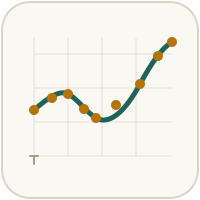

<table>
<tr>
<td width="110"></td>
<td>

# VES Field Assistant

A mobile-first, offline-capable tool for logging and interpreting **Vertical Electrical Sounding (VES)** resistivity surveys directly in the field — on a phone, a tablet, or from a terminal, with no internet connection required once installed.

</td>
</tr>
</table>

Log a reading. Get a layered-earth model back. Export a report. All before you pull the electrodes.

**[Open the live app](https://hydrolithnigltd.github.io/ves-field-assistant/)**

---

## What's in this repo

| | |
|---|---|
| **`VES_Field_Assistant.html`** | The field app — a single, self-contained HTML file. Open it in any modern browser, no install, no server. |
| **`VES_Field_Assistant_Minified.html`** | The same app, minified for hosting. Rename to `VES_Field_Assistant.html` before uploading — see [Hosting this yourself](#hosting-this-yourself). |
| **`VES_Field_Assistant.py`** | A dependency-free Python CLI version of the same inversion engine, for fully offline terminal use (e.g. via Termux on Android). |
| **`manifest.json`** + **`sw.js`** | Makes the hosted app installable and usable fully offline after the first visit — see [Installing it on your phone](#installing-it-on-your-phone). |
| **`icons/`** | App icons used by the manifest (192×192 and 512×512). |
| **`assets/`** | The logo used above. |

All three app variants share the same validated physics and fitting methods — see [How it works](#how-it-works) below.

## Features

- **Log readings as you take them** — AB/2, MN/2, and resistance, or apparent resistivity directly if that's what you already have (a prior interpretation, a different instrument, a digitized historical record).
- **Automatic inversion** — a bounded Levenberg-Marquardt solver fits a layered-earth model to your data, with two fitting philosophies shown side by side:
  - **Best fit** — minimizes raw misfit against your logged readings.
  - **Smoothed (Occam-style)** — trades a little raw fit quality for a smoother, more geologically plausible layer sequence.
- **Design Model** — build a model by hand, preview its theoretical curve, iterate toward your field data one watchable step at a time, or refine straight to a finished result.
- **Built-in validation** — catches out-of-sequence spacing, invalid geometry, and flags a sharp deceleration or reversal in the resistivity curve near your widest spacing, a pattern that can indicate a fracture or weathering zone within otherwise competent basement.
- **Session persistence** — your station survives an interrupted session (phone sleep, closed tab, crash) without needing to re-enter anything.
- **GPS + map export** — capture your station's coordinates and download a map of the location, with a direct link to open it in Google Maps.
- **Export** — CSV data, a formatted HTML report, and downloadable charts and model images.
- **Installable and fully offline once hosted** — add it to your phone's home screen like a native app; after the first visit, it keeps working with zero connection, including GPS capture.

## Getting started

### Web app (standalone file)
Download `VES_Field_Assistant.html` and open it in a browser. That's it — logging, inversion, and export all work immediately.

> **Note:** GPS capture specifically needs the page served over `https://` or opened via `localhost` — browsers block it on an insecure origin such as a raw local file or an Android `content://` link. Everything else works regardless of how the file is opened.

### Installing it on your phone
If this app is hosted (see below), visiting the link once while online installs it for full offline use afterward — no browser tab, no reconnecting needed:

1. Open the hosted link in Chrome (Android) or Safari (iOS).
2. Use "Add to Home Screen" (iOS) or the install prompt / menu option (Android/Chrome).
3. Launch it from your home screen from then on, connected or not. GPS capture keeps working offline too, since it depends on the page's `https://` origin, not on an active connection.

### CLI
```bash
python3 VES_Field_Assistant.py
```
No third-party dependencies — just the Python standard library.

### Hosting this yourself
To host your own copy with offline install support via GitHub Pages:

1. Rename `VES_Field_Assistant_Minified.html` to `VES_Field_Assistant.html`. The manifest and service worker both expect that exact filename.
2. Upload it alongside `manifest.json`, `sw.js`, and the `icons/` folder (keeping `icons/` as an actual subfolder) to a **public** GitHub repository — GitHub Pages on the free tier requires the repo be public.
3. In the repo's **Settings → Pages**, set the source to deploy from your main branch, root folder.
4. Your app is live at `https://<username>.github.io/<repo>/VES_Field_Assistant.html`.

Hosting the plain (non-minified) `VES_Field_Assistant.html` works too — minification isn't required for the app to function, it just makes casual reading of the source less convenient.

## How it works

The forward model is a **Ghosh (1971)** recursive resistivity transform combined with a **28-point digital linear filter** (Murakami, Zerilli & Bisdorf, 1984 — public domain), the same class of physics used in established VES interpretation software. Inversion is handled by a bounded **Levenberg-Marquardt** least-squares solver with a multi-seed restart strategy.

VES soundings are mathematically non-unique — multiple different layered models can produce nearly identical curves (geoelectrical equivalence). This app is built around that fact rather than hiding it: it's a tool to sharpen field judgment, not a replacement for it. Always cross-check against known local geology or a nearby borehole where you can.

## Contributing

Issues and pull requests are welcome. If you're proposing a change to the inversion engine itself, please include the test case (real or synthetic) you validated it against — this project treats reproducibility against real field data as a first-class requirement, not an afterthought.

## License

*(Add your chosen license here — e.g. MIT, Apache 2.0, or All Rights Reserved.)*

## Credits

Powered by **Asije Labs**.
